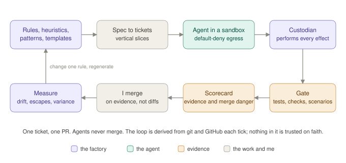
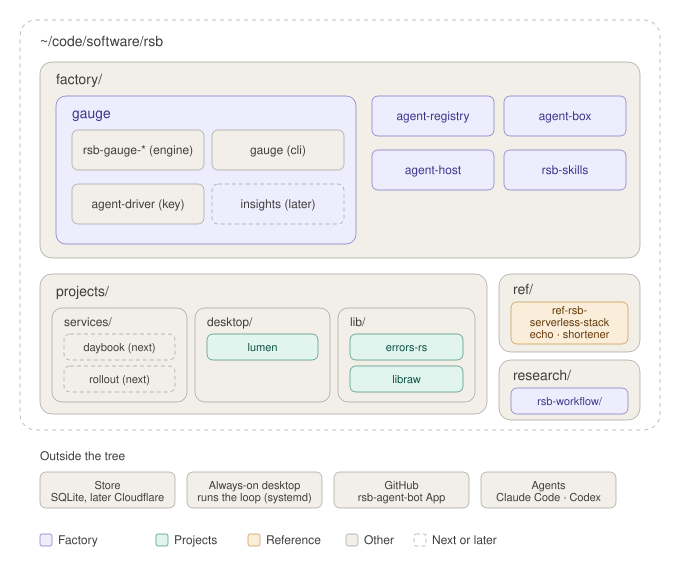

# RSB

**I'm building a software factory to keep me connected to the code.**

I've stopped writing the code by hand. Instead I write what shapes it: the rules, checks, heuristics and patterns every change is held to. That is how I stay connected to code I no longer type.

> Public so far: [gauge](https://github.com/rsb/gauge), [agent-box](https://github.com/rsb/agent-box), [agent-registry](https://github.com/rsb/agent-registry), [rsb.sh](https://github.com/rsb/rsb.sh), [libraw](https://github.com/rsb/libraw) and [errors-rs](https://github.com/rsb/errors-rs). The rest open as the system gets built.
>
> **Start here:** the [agent-registry](https://github.com/rsb/agent-registry) README shows how the rules reach an agent, and [agent-box](https://github.com/rsb/agent-box) shows the sandbox it runs in.

The factory is a feedback loop around coding agents. I write the rules and the measurements; agents write the code inside a default-deny sandbox, holding nothing but their own model sign-in; a custodian performs every effect on their behalf; CI and reviewers produce evidence; I merge on that evidence instead of reading every diff. When the evidence lies, I add a rule or a template, regenerate the same app from the same tickets, and measure whether it got better. Nothing is adopted on faith, including my own design choices.

The other half of the work is the record: every load-bearing decision is written down, argued, dated, and held to, and published as the pieces open. The code is what the record produced.

## The shape of it

Rules are few and mostly prohibitions. Each carries a consequence: rules that guard the business or keep the agent inside its limits block the change; rules about coherence accrue debt in a ledger and get paid down on their own timeline. Every profile has a reference app that is regenerated to test the rules, never the other way round.

## Where it lives

One folder per repo role. The factory never hosts an agent attempt; agents only ever work in `projects/` and `ref/`. The loop runs on an always-on desktop under systemd and is driven from the issue tracker, so work can be started from anywhere.

## The factory

- [gauge](https://github.com/rsb/gauge) — the engine: a stateless reconciler that derives each run from git and GitHub, supervised by systemd, Rust. Holds the driver that alone touches GitHub.
- [agent-box](https://github.com/rsb/agent-box) — the sandbox an attempt runs in. Default-deny egress, no GitHub token, SSH key or Docker socket, read-only everything the agent doesn't own.
- [agent-registry](https://github.com/rsb/agent-registry) — rules, heuristics, checks, patterns and profiles, as TOML, versioned.
- `rsb-skills` — the spec, ticket and hand-back skills the agents and I both use.
- [rsb.sh](https://github.com/rsb/rsb.sh) — the engineering record and, eventually, the published rules and data so you can build your own.

The remaining private pieces open as they stabilize; the rules and the data are the point of publishing, not the code.

## What it builds

- **Lumen** — a raw developer and photo catalog for the Linux desktop, built for my own photographs first. Local files, no subscriptions, no telemetry, no cloud. Rust. ([libraw](https://github.com/rsb/libraw) bindings and [errors-rs](https://github.com/rsb/errors-rs) are its first open crates.)
- **Rollout** — feature-flag management on Kubernetes. The reference application for the k8s profile.
- **Daybook** — double-entry ledger accounting for small creative businesses. The public example of a complete serverless system, with a live demo when it ships.
- **Reference apps** — one per stack profile, deliberately small, rebuilt from fixed tickets every time a rule changes.

Three families of software, each with its own profile: serverless TypeScript on Cloudflare, Rust and TypeScript for Kubernetes services, and Rust desktop applications.
